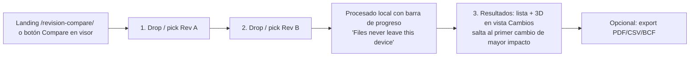

# 05 — UX de Revision Compare (resultados, flujo, presentación comercial)

Fecha: 2026-11-13. Fase 1 (descubrimiento). Fuente de la necesidad: `docs/revision-compare/00-plan.md:3-5`.

Persona: ingeniero/jefe de obra en contratista (Tailandia, prefabricado — SUPUESTO), no BIM manager. Usa tablet/móvil en obra y portátil en caseta (SUPUESTO). Su pregunta no es "¿qué diferencias hay en el modelo?", sino "**¿qué tengo que cambiar en lo que ya fabriqué, pedí o monté?**".

Restricción dura: los ficheros nunca salen del navegador (regla local-first, `00-plan.md:11`; AGENTS.md regla 1 y 2: gratis = sin servidor).

Leyenda de evidencia: `ruta:línea` o URL; si no, `SUPUESTO`. URLs de competencia tomadas de conocimiento previo, **no reabiertas hoy** (marcadas "sin verificar 2026-11-13"); comprobar antes de citarlas en la landing.

---

## 1. Principios de diseño

1. **Lista primero, 3D después.** El ingeniero piensa en "lista de cambios para revisar", no en navegar un modelo. La lista es el eje; el 3D es el contexto de cada cambio. (SUPUESTO, coherente con JTBD 1 en `00-plan.md:9`.)
2. **Nada se escapa**: contador grande "N cambios, M revisados". Cada cambio tiene estado (pendiente / revisado / afecta a obra). Es el antídoto directo a "unmarked changes".
3. **Lenguaje de obra, no de IFC**: "Moved 120 mm east", "Height 3000 → 3200 mm", "New element", no "IfcLocalPlacement changed".
4. **Mismo código de color en todo** (3D, lista, tabla, informe, landing, GIF).
5. **Todo local**: badge permanente "Files stay on this device" en la cabecera del comparador.

## 2. Código de color

Cinco categorías, elegidas para distinguirse también en daltonismo (no depender solo de rojo/verde: cada una lleva icono + letra).

| Categoría | Color (token propuesto) | Icono/letra | Regla de detección (SUPUESTO, se fija en 10-spec) |
|---|---|---|---|
| Añadido | verde `#2E9E5B` | `+` A | GlobalId solo en B |
| Eliminado | rojo `#D64545` | `−` R | GlobalId solo en A (se dibuja como fantasma rojo, posición de A) |
| Movido | azul `#2F6FDE` | `→` M | mismo GlobalId, misma geometría, placement distinto > tolerancia |
| Reformado (geometría) | naranja `#E08A1E` | `◇` G | mismo GlobalId, bbox/volumen/hash de malla distinto |
| Propiedades cambiadas | violeta `#8B5CF6` | `≡` P | geometría igual, Psets/atributos distintos |
| Sin cambios | gris neutro, fantasma 10–15 % | — | contexto |

Un elemento puede ser "Movido + Propiedades": se pinta con el color de mayor impacto en obra (Reformado > Movido > Añadido/Eliminado > Propiedades — SUPUESTO, validar con el usuario) y la lista muestra ambas etiquetas.

Los colores deben entrar como tokens del sistema de color existente (memoria `project_color_system_research.md`; no añadir hex sueltos). Tolerancia de movimiento configurable (por defecto 5 mm — SUPUESTO; prefabricado trabaja con tolerancias de mm).

## 3. Modos de vista

### 3.1 Vista por defecto: "Cambios" (fantasma)
Sin cambios = fantasma gris translúcido; cambiados = color sólido; eliminados = contorno rojo en su posición antigua. Movidos: fantasma azul en A + sólido en B + flecha de desplazamiento con cota en mm.

### 3.2 Slider A/B (cortina)
Una línea vertical arrastrable sobre el visor: izquierda renderiza A, derecha B, misma cámara. Es el gesto que el usuario ya conoce de Bluebeam/compare de imágenes. Implementación por scissor test en el mismo canvas (SUPUESTO técnico).

### 3.3 Vista partida (split)
Dos viewports con cámara sincronizada (A | B). En tablet vertical se apilan (A arriba, B abajo). Útil para revisar un elemento reformado.

### 3.4 Alternar (blink)
Botón/tecla `Space` que alterna A↔B en el mismo viewport: el ojo detecta el salto. Barato y muy efectivo en móvil.

```
+-------------------------------------------------------------------+
| ◀ Back   Revision compare   A: Rev03.ifc  ⇄  B: Rev04.ifc   🔒 local|
| [Changes] [Slider] [Split] [Blink]          42 changes · 12 reviewed|
+----------------------+--------------------------------------------+
| FILTERS              |                                            |
| Storey  [L2 ▾]       |        3D VIEW (ghosted context)           |
| Discip. [Struct ▾]   |                                            |
| Type    [Column ▾]   |     ░░░░░░░█(orange)░░░░░░░                |
| ☑ +Added    (8)      |     ░░░  ▣ blue ghost → ■ blue  ░░░        |
| ☑ −Removed  (3)      |     ░░░░░░▢(red outline)░░░░░░░             |
| ☑ →Moved    (14)     |                                            |
| ☑ ◇Reshaped (9)      |  ┌ Column C-12 ─────────────┐              |
| ☑ ≡Props    (8)      |  │ Moved 120 mm E, 0 mm N   │              |
|----------------------|  │ Height 3000 → 3200 mm    │              |
| CHANGE LIST  ↑↓ / J K|  │ [Prev] [✓ Reviewed] [Next]│             |
| ▸ L2 · Struct        |  └──────────────────────────┘              |
|  ◇ C-12  Column  ●   |                                            |
|  → B-204 Beam    ●   |                                            |
|  + W-31  Wall    ✓   |                                            |
| ▸ L3 · Arch (11)     |                                            |
+----------------------+--------------------------------------------+
| [Export report PDF/CSV] [Export BCF]   [Before/after table ▴]      |
+-------------------------------------------------------------------+
```

## 4. Filtros

- **Planta** (IfcBuildingStorey), **disciplina** (por fichero/prefijo de tipo o federación existente — ver memoria `project_federation_controls.md`), **tipo** (IfcClass legible: "Column", no "IfcColumn").
- **Categoría de cambio** (5 checkboxes con contadores).
- **Mis elementos**: filtro por Tag/Mark/ID de pieza prefabricada (SUPUESTO: en prefabricado el número de pieza es lo que se pide a fábrica). Pegar lista de marcas ya fabricadas → resaltar cambios que afectan a piezas ya producidas (JTBD 2, `00-plan.md:9`).
- Los filtros afectan a lista, 3D, tabla y export a la vez.

## 5. Lista de cambios navegable

- Agrupada Planta → Disciplina → elemento; orden por impacto.
- Teclado: `J/K` o `↑/↓` siguiente/anterior, `R` revisado, `F` encuadrar. Clic = encuadrar + aislar con contexto fantasma.
- Estado por cambio: pendiente ● / revisado ✓ / "afecta a obra" ⚠ (+ nota). Persistido en `localStorage`/IndexedDB por par de ficheros (hash) — local.
- Lista virtualizada (ya hay patrón de listas virtuales en el panel del gemelo, memoria `project_twin_panel_ux.md`).

## 6. Tabla antes/después

Panel inferior desplegable, una fila por propiedad cambiada del elemento seleccionado (o de todos, en modo tabla completa):

```
| Element | Field            | Rev03 (A)  | Rev04 (B)  | Δ        |
|---------|------------------|------------|------------|----------|
| C-12    | Position X       | 12 400 mm  | 12 520 mm  | +120 mm  |
| C-12    | Height           | 3 000 mm   | 3 200 mm   | +200 mm  |
| C-12    | Pset_Concrete... | C30/37     | C35/45     | changed  |
| W-31    | —                | (none)     | new        | added    |
```

Exportable a CSV y a informe PDF con captura por cambio (JTBD 3: documento para obra y para reclamar al proyectista). BCF reutiliza el exportador existente (memoria `project_bcf_panel.md`, `project_validation_export.md`).

## 7. Móvil / tablet en obra

Reutilizar `MobileSheet` con detents (`src/components/mobile/MobileSheet.tsx:6` "snapPoints: dvh fractions ... peek / half / full"; props en `:30-38`).

```
 Tablet/phone portrait
+---------------------------+
| Rev03 ⇄ Rev04   🔒  42 ⚠ |
| [Changes][Slider][Blink]  |
|                           |
|      3D (full width)      |
|   ░░░█░░░  ■→■  ░░        |
|                           |
|  ◀ prev  3/42  next ▶     |  <- botones grandes, pulgar
+===========================+
| ═══ (peek 16%)            |
| ◇ C-12 Column · L2        |
| Moved 120 mm E · H +200mm |
| [✓ Reviewed] [⚠ Site]     |
+---------------------------+
  half (55%): lista filtrada
  full (92%): tabla antes/después
```

- Peek = tarjeta del cambio actual; deslizar arriba = lista; full = tabla.
- Navegación con botones prev/next de 44 px+ (uso con guantes/sol — SUPUESTO).
- Slider A/B con el dedo; split en vertical apilado; Blink por botón.
- Modelos grandes en móvil: avisar y ofrecer `.frag` / perfil de memoria existente (memoria `project_mobile_memory_perf.md`).
- Modo alto contraste para exterior (SUPUESTO, deseable).

## 8. Flujo de 3 clics



- Una sola pantalla con dos zonas de soltar ("Old revision" / "New revision"); permitir soltar los dos a la vez y ordenarlos por fecha de fichero/`IfcOwnerHistory` (SUPUESTO) con botón ⇄ para invertir.
- La comparación arranca sola al tener los dos (clic 3 = ver resultados, ya abiertos).
- Reutiliza LoadManager (memoria `project_model_loading_manager.md`) y el trabajo de comparar conjuntos en worktree `ifc-compare` (memoria `project_version_compare.md`, sin commitear — revisar en 01-inventario antes de reinventar).

## 9. Cómo lo presentan los competidores (sin verificar 2026-11-13)

| Producto | Cómo presenta el cambio | URL |
|---|---|---|
| Bluebeam Revu — Overlay Pages / Compare Documents | 2D: superpone dos PDF en rojo/azul (Overlay) o nubes automáticas alrededor de diferencias (Compare). Es la referencia mental del usuario de obra. | https://support.bluebeam.com/revu/features/overlay-pages.html · https://support.bluebeam.com/revu/features/compare-documents.html |
| Autodesk Construction Cloud (Docs) — compare | 2D sheets: superposición con colores por versión y lista de cambios; 3D: compare de versiones de modelo con añadido/eliminado/modificado en verde/rojo/amarillo-naranja y lista. Requiere nube y licencia. | https://help.autodesk.com/view/DOCS/ENU/?guid=Compare_Versions · https://construction.autodesk.com/ |
| Solibri Office — Model comparison | Compara dos versiones de modelo; resultados como categorías añadido/eliminado/modificado en tabla con 3D; orientado a BIM coordinator, licencia de escritorio. | https://www.solibri.com/ (ver Solibri Help "Comparing Models") |
| Navisworks — Compare | Compara dos ficheros/selecciones, resultados como sets y colores; escritorio Windows. | https://help.autodesk.com/view/NAV/ENU/ |
| BIMcollab Zoom / Trimble Connect | Comparar versiones en visor (SUPUESTO de detalle; confirmar en 03-competencia). | https://www.bimcollab.com/ · https://connect.trimble.com/ |

Lecciones: (a) todos usan un **código de color + lista**; (b) Bluebeam gana a la gente de obra por ser 2D y rápido → nuestro mensaje es "Bluebeam overlay, pero para el modelo, en el navegador, sin subir nada"; (c) ACC/Solibri piden nube o licencia → nuestro diferencial es gratis + local + móvil. Profundizar en `03-competencia.md`.

## 10. Presentación comercial

### 10.1 Landing dedicada
- Slug: `/revision-compare/` (alias SEO: "compare IFC revisions", "IFC model diff", "find changes between IFC versions" — validar con GSC/keyword research, SUPUESTO).
- Generada ×10 idiomas con el mismo generador/chrome de las landings core (memorias `project_core_landings_generator_2026-11.md` — `npm run seo:core` — y `project_landings_redesign_2026-11.md` — `landing-chrome.ts`). No editar HTML a mano. Capturas reales del visor (receta `landing-captures/capture.cjs`, memoria `project_generated_landings_captures_2026-11.md`).
- Estructura:
  1. H1: "Find every change between two IFC revisions — in your browser". Sub: "Added, removed, moved, reshaped. Files never leave your device."
  2. Bloque demo en vivo (fachada live-embed, memoria `project_seo_landing_pages.md`) con el par de muestra precargado.
  3. Dropzone "Try with your own two files" (3 clics).
  4. Tres capturas: vista Cambios, slider A/B, móvil en obra con la tarjeta.
  5. "Built for site teams": prefab piece IDs, PDF report for the designer, works on a tablet.
  6. Comparativa honesta y fechada (Bluebeam / ACC / Solibri) con fuente, como en las landings core.
  7. FAQ: privacidad, tamaño máximo (no prometer más de lo medido; memoria de core landings: "2 GB"), formatos (IFC; 2D PDF pendiente de confirmar, `00-plan.md:7`).
- Gratis: corre en navegador → encaja en Free. Si se añade lote/historial de N revisiones o informe con marca, valorar Pro por regla opción C (AGENTS.md regla 1). Decisión fuera de este doc.

### 10.2 Demo con par de modelos de muestra
- Par "Rev A / Rev B" de un pequeño edificio prefabricado (pilares, vigas, paneles) con ~20 cambios sembrados que cubren las 5 categorías y al menos 2 plantas/2 disciplinas.
- Servido desde el Worker de modelos (`public/models/...` → `npm run deploy:models`, AGENTS.md regla 6).
- Enlace profundo: `/?compare=demo` (SUPUESTO de parámetro; alinear con params embed, memoria `project_embed_url_params.md`).

### 10.3 Storyboard GIF/vídeo de 30 s
| t | Plano | Texto en pantalla |
|---|---|---|
| 0–3 s | Dos PDFs/IFC "Rev03", "Rev04" arrastrados a la dropzone | "Two revisions. No marked changes." |
| 3–7 s | Barra de progreso + candado | "Compared on your device. Nothing uploaded." |
| 7–12 s | Vista Cambios, contador "42 changes" | "Every change, colour-coded." |
| 12–17 s | Clic en "C-12 Column" → vuela la cámara, tarjeta "Moved 120 mm, +200 mm high" | "Jump straight to what changed." |
| 17–21 s | Slider A/B arrastrado sobre la columna | "Before / after." |
| 21–25 s | Filtro "L2 · Structure" + marcar ✓ revisado | "Filter by floor, check them off." |
| 25–28 s | Tablet en obra, tarjeta en sheet, botón Next | "Works on site." |
| 28–30 s | Export PDF + logo + URL | "Free. ifcvieweronline.eu/revision-compare" |

Grabar con la receta de capturas existente; sin voz, subtítulos en inglés; exportar MP4 + GIF ligero (< 3 MB).

### 10.4 Correo de respuesta al usuario (inglés)

> Asunto: Re: unmarked changes on revised drawings
>
> Hi [name],
>
> Thank you for telling us about this — unmarked changes between revisions causing rework and conflicts on site is exactly the problem we want to fix.
>
> We are building a free "Revision Compare" in IFC Viewer Online: you drop the old and the new revision, and it shows every element that was added, removed, moved or changed, colour-coded, as a checklist you can go through on a tablet, with a before/after report you can send back to the designer. Everything runs in your browser — your files are never uploaded to us.
>
> Would you like to try it with a real pair of your own revisions? Two quick questions so we get it right for you:
> 1. Are your revisions IFC models, PDF/DWG drawings, or both?
> 2. Roughly how big are the files, and do you use piece/mark numbers for the precast elements?
>
> If you reply, I'll send you a link as soon as it's ready (or a 15-minute call if that's easier).
>
> Best regards,
> Joel
> IFC Viewer Online

No enviar sin OK de Joel (puerta de aprobación, `00-plan.md:11`). No mencionar IA (AGENTS.md regla 4).

## 11. Preguntas abiertas (→ Puerta 1)
1. IFC vs PDF/DWG 2D (bloquea si la UX principal es 3D o overlay 2D tipo Bluebeam).
2. Prioridad de categorías cuando se combinan; tolerancias por defecto.
3. ¿Identidad por GlobalId basta? Los proyectistas a veces regeneran GUIDs → hace falta emparejar por Tag/tipo/posición (riesgo alto, llevar a 04-casuisticas).
4. Free vs Pro para informe PDF / historial de revisiones.
