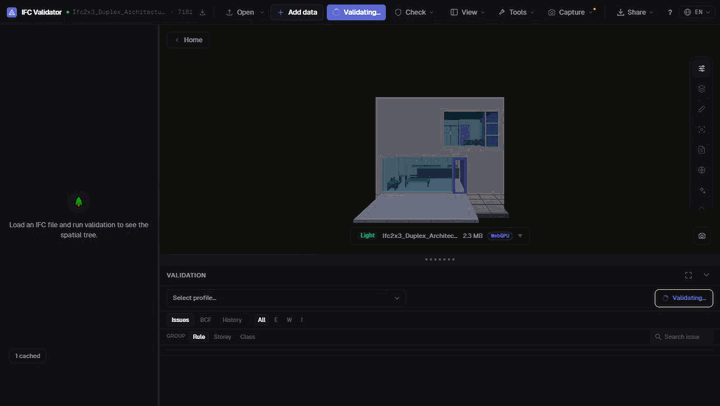
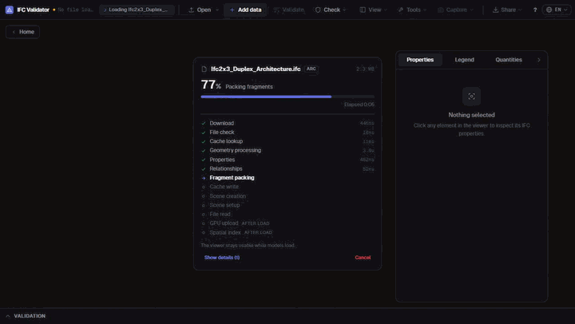
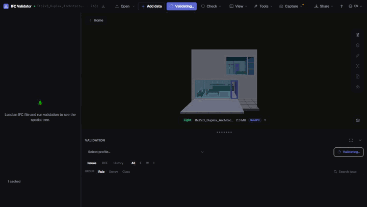
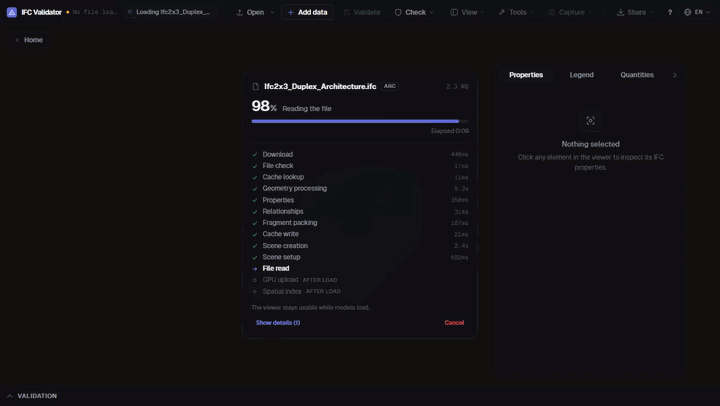
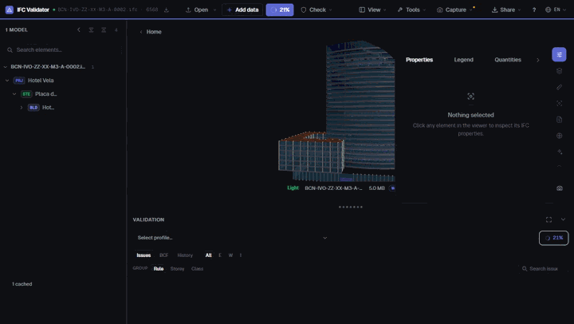
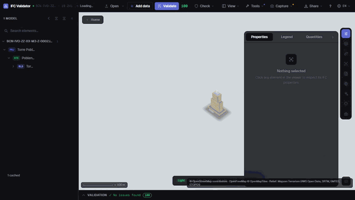
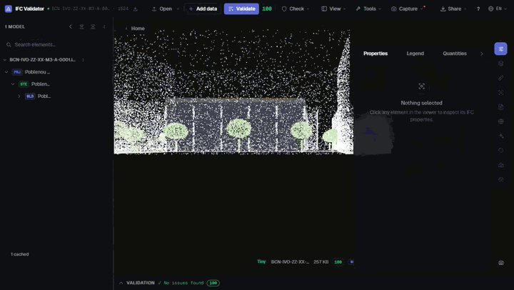
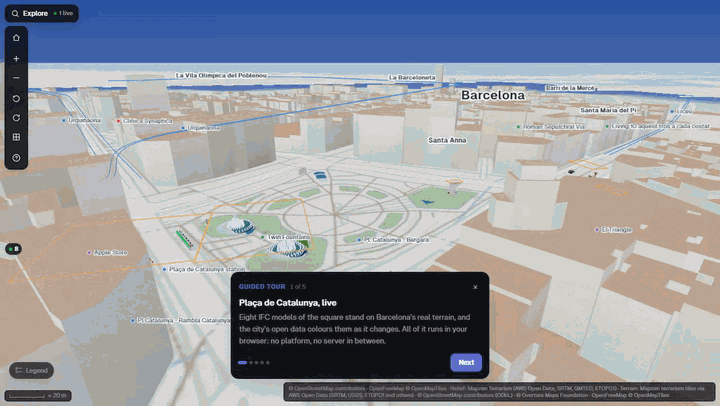
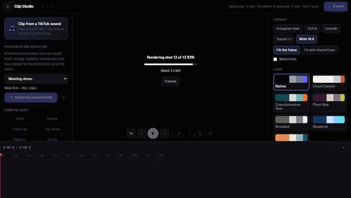
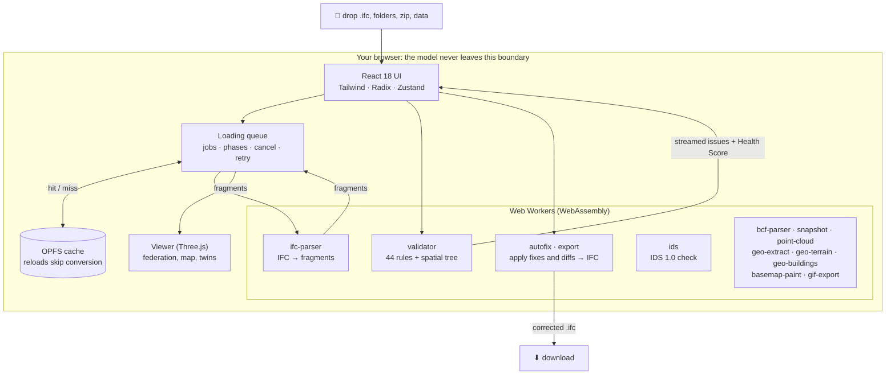

<div align="center">

# IFC Viewer Online

**Open an IFC file and get a Health Score (0 to 100) in 30 seconds. Then put it on a map, measure it, compare it and turn it into a live digital twin.**

A free IFC viewer, validator and digital-twin toolkit that runs entirely in your browser.
No account. No file size limit. Your models never leave your machine.

[**→ Try it live**](https://www.ifcvieweronline.eu/) · [Demos](https://www.ifcvieweronline.eu/msp-global/) · [SDK docs](https://www.ifcvieweronline.eu/sdk/) · [Blog](https://www.ifcvieweronline.eu/blog/)

<br/>

[](https://www.ifcvieweronline.eu/)
[](LICENSE)
[](CONTRIBUTING.md)
[](https://github.com/j03rul4nd/ifc-viewer-online/stargazers)


<br/>

**Read this in your language**

English · [简体中文](README.zh-CN.md) · [Español](README.es.md) · [Français](README.fr.md) · [Deutsch](README.de.md) · [日本語](README.ja.md) · [Português](README.pt.md) · [Català](README.ca.md) · [Italiano](README.it.md) · [ไทย](README.th.md)

</div>

---

<div align="center">

[](https://www.ifcvieweronline.eu/)

<sub><i>Health Score and Fix this first → a live city twin → sun and climate → point clouds → Clip Studio. All in your browser. <a href="https://www.ifcvieweronline.eu/">Try it live →</a></i></sub>

</div>

> **In one sentence:** drag in one IFC or a whole federated project, see it in 3D (on a real map if you want), get a Health Score with the issues to fix first, fix the common ones in a click, measure and compare versions, and export a corrected file, BCF or report. Nothing is uploaded to a server.

## Contents

- [What it does](#what-it-does)
- [See it in action](#see-it-in-action)
- [Embed it: iframe, SDK, WordPress](#embed-it-iframe-sdk-wordpress)
- [How it works](#how-it-works)
- [Getting started](#getting-started)
- [Project structure](#project-structure)
- [Documentation map](#documentation-map)
- [The 44 validation rules](#the-44-validation-rules)
- [Contributing](#contributing)
- [Open source, free and paid](#open-source-free-and-paid)
- [License](#license)

---

## What it does

### Check and fix models

| Capability | What you get |
|---|---|
| **IFC Health Check** | 44 validation rules streamed live from a Web Worker, summarized as one **Health Score (0–100)**, with a *Fix this first* list right under the score and *Show in 3D* on every row. |
| **One-click fixes** | A browser engine that fixes missing types, renames every duplicate or empty name in one go, and suggests the real class for `IfcBuildingElementProxy` elements. You see the Health Score of the fixed file before you download it. |
| **Fix guides** | Step-by-step remediation per rule for Revit, ArchiCAD, Tekla and Allplan. The guide opens on the tool the model was exported from. Also published as static [`/fix/`](https://www.ifcvieweronline.eu/fix/) pages in 10 languages. |
| **buildingSMART IDS 1.0** | Load an `.ids` file and check the model against it: all six facets (entity, attribute, property, classification, material, partOf), tested against the official buildingSMART test cases. Export to JSON / CSV / HTML / BCF. |
| **EIR profiles and requirements** | Build an Exchange Information Requirements profile (or import it from an Excel template) that compiles to IDS, and share a requirements link with suppliers. |
| **Version compare** | Compare *sets* of IFCs between deliveries by GlobalId, check that IDS compliance did not regress, and sync the BCF issue list. See [`docs/VERSION_COMPARE.md`](docs/VERSION_COMPARE.md). |
| **Non-destructive editor** | Edit properties, fix GUIDs, rename elements. Every change is a diff with undo/redo; the corrected IFC is written in a worker. |
| **BCF 2.1 / 3.0** | Import, create and comment topics in a BCF panel; viewpoints, measurements and validation findings travel inside the issue. Works with Navisworks, BIMcollab, Solibri and any BCF-compatible CDE. |
| **Reports** | Shareable, crawlable report links, a verifiable certificate, COBie export and validation export to JSON / CSV / BCF. |

### View, measure and present

| Capability | What you get |
|---|---|
| **Federation** | Drop a whole project at once: many IFCs, folders, ZIP, RAR or 7z. A federation bar groups models by discipline, with colour, opacity, versions and saved views. Every load is a queued job you can follow, cancel or retry. |
| **Coordinates** | Models with UTM coordinates in their vertices, or a local model next to a georeferenced one, are lined up through `IfcMapConversion`. See [`docs/FAR_COORDINATES.md`](docs/FAR_COORDINATES.md). |
| **Measure** | Distance, area, angle, clearance and shortest gap; CAD dimensions (aligned, chain, baseline, level, radius, arc, angular, ordinate, leaders) with polar tracking and snaps; quantity takeoff with pass/fail requirements; routes on foot, by bike or by car inside buildings and across the city ([`docs/ROUTING.md`](docs/ROUTING.md)). |
| **Explore** | Spatial tree and scene tree, section cuts, 2D floor plans, walk mode, arrow-key navigation, SSAO, edges and bloom. |
| **Present** | Guided issue tours, a presentation director, screenshot / GIF / MP4 capture with a clip editor, a cover studio with 20 templates, and a client mode for showing a model to someone who does not use BIM tools. |
| **OPFS cache** | Parsed geometry is cached in the browser's private file system, so reloads skip conversion. |
| **Mobile** | Bottom sheets for every panel, a floating nav and touch controls down to 320 px, with a lighter scene on phones. |
| **10 languages** | EN · ES · FR · DE · PT · JA · CA · ZH · IT · TH |

**Supported IFC versions:** IFC2x3 · IFC4 · IFC4x1 · IFC4x3

### Maps, reality capture and digital twins

| Capability | What you get |
|---|---|
| **3D map** | Place a georeferenced model on a real basemap with 3D terrain and the surrounding city from OpenStreetMap and Overture: buildings with real roofs and facades, roads, tunnels and metro, water with tide and currents. See [`docs/GIS_MAP_MODE.md`](docs/GIS_MAP_MODE.md). |
| **Add data** | One door for everything that is not the IFC: point clouds (LAS/LAZ/COPC/PLY/PCD/XYZ/E57), meshes, GeoJSON/WFS layers, live feeds, 3D video, IDS, BCF and documents. See [`docs/ADD_DATA.md`](docs/ADD_DATA.md). |
| **Analyses** | Sun and shadow studies with real weather files, 2D flood simulation on the GPU, and rain-triggered slope hazard. See [`docs/SOLAR_ANALYSIS.md`](docs/SOLAR_ANALYSIS.md), [`docs/FLOOD_SIMULATION.md`](docs/FLOOD_SIMULATION.md), [`docs/SLOPE_HAZARD.md`](docs/SLOPE_HAZARD.md). |
| **Digital twins** | Devices that colour IFC elements over WebSocket, alerts and history, live open data, and shareable **scene documents** (`?scene=`) that describe a whole twin in one JSON. Build your own AGV warehouse or import tracker in `/twin-builder`. See [`docs/DIGITAL_TWIN_PLATFORM.md`](docs/DIGITAL_TWIN_PLATFORM.md), [`docs/SCENE_FORMAT.md`](docs/SCENE_FORMAT.md) and [`docs/DEMOS.md`](docs/DEMOS.md). |

Some of these modules are behind build flags (`VITE_FEATURE_GIS`, `VITE_FEATURE_POINTCLOUD`, `VITE_FEATURE_MESH`, `VITE_FEATURE_VIDEO`, `VITE_FEATURE_SOLAR`, `VITE_FEATURE_FLOOD`, `VITE_FEATURE_HAZARD`). See [`docs/DEPLOYMENT.md`](docs/DEPLOYMENT.md).

---

## See it in action

> Every clip is the **real app** running in a browser, with no edited footage. The first three use the open [Duplex Apartment](public/Ifc2x3_Duplex_Architecture.ifc) reference IFC (7,131 elements); the rest use the Barcelona reference models in `public/models/`. Re-record them with `scripts/gif/capture.mjs`, `scripts/gif/features.mjs` and `scripts/gif/flood-frames.mjs`, then `scripts/gif/encode.mjs` / `scripts/gif/montage.mjs` (the header GIF).

### Navigate the model and inspect IFC properties



### Highlight every issue in 3D



### Export a corrected model



### Sun and climate analysis

One link loads the model, reads the site's real climate (ERA5) and paints the passive sun impact on every facade, hour by hour.



### Rain and flooding on the map

The Hotel Vela on Barcelona's real relief, with the city around it: a 2-hour storm runs as a 2D flood simulation on the GPU, then the maximum depth it left.



### Point clouds next to the IFC

A construction-progress scan aligned with the IFC it surveys, in the same scene.



### A city digital twin from one scene file

`?scene=` opens eight IFC models in Plaça de Catalunya, Barcelona, on the city map with live open data.



### Clip Studio

Generate a presentation from the model (storeys, systems, findings) and edit it into a clip for LinkedIn, Reels or TikTok.



---

## Embed it: iframe, SDK, WordPress

Put the viewer in a blog, a CDE panel, a dashboard or an internal tool. The model is parsed in the visitor's browser, **nothing is uploaded**.

**1. Iframe and URL params**

```html
<iframe src="https://www.ifcvieweronline.eu/?model=https://your-cde.com/model.ifc&embed=1"
        width="100%" height="600" style="border:0" allow="fullscreen"></iframe>
```

`model` (comma-separated for federated sets), `scene`, `embed`, `ui` (`minimal` · `full` · `kiosk` · `client` · `article`), `validate`, `select`, `isolate`, `lang` and more. Full reference: [`docs/EMBED_URL_PARAMS.md`](docs/EMBED_URL_PARAMS.md).

**2. JS SDK (v1.18)**: mount the viewer and stream IFC bytes from your own app, with no public URL and no CORS.

```html
<div id="viewer" style="height:520px"></div>
<script type="module">
  import { IfcViewer } from "https://www.ifcvieweronline.eu/sdk/ifc-viewer.es.js";
  const viewer = new IfcViewer("#viewer");
  const bytes = await fetch("/models/project.ifc").then(r => r.arrayBuffer());
  await viewer.add("project.ifc", bytes);   // parsed client-side
  viewer.on("element-selected", (e) => console.log(e.ifcType, e.expressId));
</script>
```

A small, dependency-free ES module (iframe + `postMessage`). It can read stats, issues and validation results, take screenshots, run an IDS check (`checkIds(idsXml)`), drive scenes, layers and devices, and listen for `ready`, `model-loaded`, `validation-completed` and `element-selected`. Reference: [`docs/IFC_VIEWER_SDK.md`](docs/IFC_VIEWER_SDK.md) · live docs at [`/sdk/`](https://www.ifcvieweronline.eu/sdk/).

**3. WordPress**: a plugin to embed the viewer in posts and pages, in [`integrations/wordpress/`](integrations/wordpress/).

---

## How it works

The whole pipeline lives in the browser. Every load is a job in one loading queue. IFC files are converted in a Web Worker with WebAssembly, rendered with Three.js, and validated in another worker. **Nothing about your model is sent to a server of ours.** Map tiles and open-data layers are fetched by the browser straight from each provider, and only after you agree to it.



- **State:** small [Zustand](https://github.com/pmndrs/zustand) stores in `src/stores/`; geometry never enters a store, only stable IDs do.
- **Worker boundaries:** every worker message is checked at runtime with [Zod](https://zod.dev) schemas (`src/lib/worker-schemas.ts`).
- **Deep dives:** [`ARCHITECTURE.md`](ARCHITECTURE.md) (data flow), [`docs/MODEL_LOADING.md`](docs/MODEL_LOADING.md) (queue, scheduler, cache), [`DECISIONS.md`](DECISIONS.md) (why things are the way they are).

### Tech stack

| Layer | Technology |
|---|---|
| IFC parsing | [web-ifc](https://github.com/ThatOpenCompany/web-ifc) (WebAssembly) |
| 3D rendering | [Three.js](https://threejs.org/) + [@thatopen/components](https://github.com/ThatOpenCompany/engine_components) / fragments |
| Maps | [3d-tiles-renderer](https://github.com/NASA-AMMOS/3DTilesRendererJS), OpenFreeMap vector tiles, OpenStreetMap / Overture data |
| UI | React 18 + Tailwind CSS + Radix UI, Framer Motion + GSAP |
| State | Zustand 5 |
| i18n | i18next (10 languages) |
| Analytics | PostHog EU, cookieless, no PII, opt-out respected |
| Build / tests | Vite 6 + TypeScript (strict) · Vitest |
| Deploy | Vercel (static) · Cloudflare Worker for share links and contact forms (never sees the model) |

---

## Getting started

Requirements: Node.js 20+ and npm.

```bash
git clone https://github.com/j03rul4nd/ifc-viewer-online.git
cd ifc-viewer-online
npm install
npm run dev    # → http://localhost:3000
```

The dev server sends `Cross-Origin-Opener-Policy: same-origin` and `Cross-Origin-Embedder-Policy: require-corp`, which multithreaded WASM (`SharedArrayBuffer`) needs.

| Command | What it does |
|---|---|
| `npm run dev` | Dev server on port 3000 (`PORT` to change it) |
| `npm test` | Vitest suite |
| `npx tsc -b` | Type check |
| `npm run build` | SDK + embed pages + type check + production build into `dist/` |
| `npm run build:sdk` | Only the SDK and its docs (`public/sdk/`) |
| `npm run frags` | Pre-compute `.frag` geometry for the demo models |
| `npm run props`, `npm run tower`, … | Rebuild demo assets with Blender 4.5 (`scripts/blender/`) |

> The build bundles Three.js and `@thatopen/*` into worker chunks and needs a lot of memory; the `build` script already raises the Node heap to 6 GB. You can also self-host with the `Dockerfile` / `docker-compose.yml` (nginx). See [`docs/DEPLOYMENT.md`](docs/DEPLOYMENT.md).

---

## Project structure

```
src/
  components/   # UI: Viewer, Toolbar, ValidationPanel, IdsPanel, BcfPanel, GeoPanel, ScenePanel, …
                #   + measure/ compare/ data/ geo/ pointcloud/ solar/ eir/ requirements/ mobile/ blog/ twin-builder/ …
  workers/      # ifc-parser · validator · autofix · export · ids · bcf-parser · snapshot · point-cloud · geo-* · basemap-paint · gif-export
  stores/       # Zustand stores (model, scene, validation, editor, loading, bcf, ids, geo, measure, …)
  hooks/        # useModelSession, useValidationRunner, useIdsRun, useElementFocus, …
  lib/          # viewer.ts · loader.ts · validator.ts · diffStore.ts · worker-schemas.ts
    loading/    # load queue, scheduler, convert pool, cache, drop plans
    ids/  eir/  autofix/  compare/  certify/  cobie/   # checking, fixing, comparing, reporting
    measure/  route/  plans/                           # measuring, dimensions, takeoff, routes
    geo/  pointcloud/  mesh/  video/  solar/           # map, reality capture, analyses
    twin/  scene/  scene-doc/  layers/  connections/   # digital twins and scene documents
    capture/  director/  cover/  presentation/  tour/  # capture and presentations
  sdk/          # IfcViewer embeddable SDK (built to public/sdk/)
  i18n/ locales/  # i18next config + JSON per locale
  types/        # Zod schemas + TypeScript types (ValidationRules, RULE_COUNT, …)
public/         # static landings, /fix/ and /blog/ pages, demo models, scenes, SDK build
scripts/        # SEO generators, blog i18n, covers, Blender asset builders, SDK docs
cf-worker/      # Cloudflare Worker: share-link SSR and contact forms (never sees the model)
integrations/   # WordPress plugin
test/           # fixtures
```

---

## Documentation map

Start with these:

| Doc | Read it for |
|---|---|
| [`ARCHITECTURE.md`](ARCHITECTURE.md) | How the app is put together and how data flows |
| [`DECISIONS.md`](DECISIONS.md) | Architecture decisions (D-xx) and the rules they set, e.g. frontend-only |
| [`CONTEXT.md`](CONTEXT.md) | Glossary and product context |
| [`IFC_DOMAIN.md`](IFC_DOMAIN.md) | IFC concepts the code relies on |
| [`CONTRIBUTING.md`](CONTRIBUTING.md) | How to send a change |
| [`docs/README.md`](docs/README.md) | **Index of every doc in `docs/`**, grouped by area, with what is a reference and what is a plan or research note |

---

## The 44 validation rules

Rules run in `src/workers/validator.worker.ts`, gated by a `RulesConfig`. The count lives in one place, `RULE_COUNT` in `src/types`, and a test fails if any doc quotes a different number. (This is separate from the buildingSMART **IDS** check, which runs your own `.ids` file.)

<details>
<summary><b>Core: 18 rules</b> (names, GUIDs, types, hierarchy)</summary>

`RULE_EMPTY_NAME` · `RULE_EMPTY_LONGNAME` · `RULE_DUPLICATE_NAME` · `RULE_NAMING_CONVENTION` · `RULE_MISSING_TYPE` · `RULE_DUPLICATE_GUID` · `RULE_MISSING_PROPERTY_SET` · `RULE_ORPHAN_ELEMENT` · `RULE_WRONG_CONTAINER` · `RULE_BROKEN_AGGREGATE` · `RULE_INVALID_GUID_FORMAT` · `RULE_SPATIAL_HIERARCHY` · `RULE_CIRCULAR_REFERENCE` · `RULE_EMPTY_PROPERTY_VALUE` · `RULE_MISSING_MATERIAL` · `RULE_ELEMENT_IN_BUILDING` · `RULE_INVALID_IFC_VERSION` · `RULE_ELEMENT_CLASH` (off by default)

</details>

<details>
<summary><b>Spatial &amp; file header: 11 rules</b> (project/site/storey, ISO 19650)</summary>

`RULE_MISSING_PROJECT` · `RULE_MISSING_BUILDING` · `RULE_MISSING_STOREY` · `RULE_EMPTY_STOREY` · `RULE_FILE_DESCRIPTION_MISSING` · `RULE_FILE_AUTHOR_MISSING` · `RULE_PROJECT_LONGNAME_MISSING` · `RULE_STOREY_ELEVATION_MISSING` · `RULE_ISO19650_PROJECT_INFO` · `RULE_ISO19650_AUTHOR_INFO` · `RULE_ISO19650_FILENAME`

</details>

<details>
<summary><b>LOD, classification &amp; MEP: 9 rules</b></summary>

`RULE_MISSING_CLASSIFICATION` · `RULE_LOD_PSET_MISSING` · `RULE_LOD_QUANTITY_MISSING` · `RULE_LOD_MATERIAL_LAYER_MISSING` · `RULE_MEP_SYSTEM_MISSING` · `RULE_CLASH_MEP_STRUCTURAL` · `RULE_PROXY_OVERUSE` · `RULE_COORDINATE_OFFSET` · `RULE_FILE_SIZE_ANOMALY`

</details>

<details>
<summary><b>Geometry &amp; storey integrity: 6 rules</b></summary>

`RULE_OPENING_WITHOUT_HOST` · `RULE_STOREY_ELEVATION_DUPLICATE` · `RULE_STOREY_ELEVATION_ORDER` · `RULE_UNIT_CONSISTENCY` · `RULE_SPACE_AREA_MISSING` · `RULE_CONNECTED_MEP`

</details>

The Health Score is a logarithmic, diminishing-returns number derived from the weighted severity of all issues (errors such as duplicate GUIDs, warnings such as missing property sets, info such as proxy overuse).

---

## Contributing

New validation rules, translations and bug fixes are especially welcome. Read [`CONTRIBUTING.md`](CONTRIBUTING.md) first.

**Add a validation rule** (`src/workers/validator.worker.ts`):

1. Add the rule ID to `ValidationRules` and its metadata in `src/types/index.ts`
2. Implement the `async` rule: it receives the `IfcAPI` instance, `modelId` and a `SpatialIndex` helper and returns `ValidationIssue[]`
3. Wire it into the `runAllRules` dispatch and set `DEFAULT_RULES[RULE_ID]`
4. Add i18n strings to `RULE_TRANSLATIONS`
5. Run `npm test`: `src/lib/rule-count.test.ts` lists every page and README that still quotes the old rule count

**Add a translation:** copy `src/locales/en/` to a new locale folder, translate the values, and register it in `src/i18n/config.ts`.

**Before opening a PR:** `npm test` and `npx tsc -b`.

---

## Open source, free and paid

**The rules we follow**

1. **Everything that is free in the browser today stays free, forever.** Nothing is taken away from anyone.
2. **What costs a server is paid:** storage, server processing, bandwidth, hosted APIs.
3. **New professional productivity tools** (for example batch work across many files) may launch in a paid plan, even when they run in the browser.
4. **The free plan gets nothing that runs on our servers**, so it never depends on an account or a quota.

**Free, open source (MIT, this repo)**

The viewer, the 44-rule validator and Health Score, one-click fixes and fix guides, buildingSMART IDS, EIR profiles, the editor and IFC export, BCF import/export, version compare, measuring and takeoff, sections and floor plans, capture and presentations, the 3D map, point clouds and data layers, solar / flood / slope analyses, digital twins and scene documents, the JS SDK, iframe embedding and the WordPress plugin. All of it runs in your browser, with no account.

**Paid plans (planned, not live yet)**

| Plan | For | What it adds |
|---|---|---|
| **Pro** | One person | Large files processed on the server, cloud projects with versions and "what changed", private links for clients (expiry, password), cloud BCF issues with free guests, verifiable certificates with your logo |
| **Team** | Studios and engineering firms (from 3 editors; reviewers and guests free) | A shared BCF issue manager, automatic validation on every upload that turns failures into assigned issues, a company standard (EIR/IDS profiles, naming), a client portal with your logo, a publishing gate with audit log, monthly reports |
| **Reception** | Contractors, developers, owners and FM teams who *receive* models | Publish your requirements as a link; suppliers check and fix for free in their browser and deliver through it; you get an inbox of what passed, what failed and who delivers well |
| **Developer** | Platforms and CDEs | Hosted validation API, billed by use |
| **Enterprise** | Large contractors and public bodies | Reception across a portfolio, SSO, DPA, SLA and isolated / on-premise deployment |

> **Not everything is in this repo.** The paid plans are built on **private, closed-source code**: the cloud backend and API, accounts and billing, storage, server processing and the team workspace. That code lives in private repositories and is not covered by the MIT license. Some paid screens exist here only as hidden UI behind flags; they do nothing without the private backend. This repo is the full free product, not the whole company.

## License

The code in this repository is [MIT](LICENSE): fork it, self-host it, use it commercially.

---

## Author

[Joel Benitez](https://github.com/j03rul4nd)

If this project saved you time, a ⭐ helps other BIM people find it.

<div align="center">

*Built with [@thatopen/components](https://github.com/ThatOpenCompany/engine_components), [web-ifc](https://github.com/ThatOpenCompany/web-ifc) and [Three.js](https://threejs.org/).*

</div>
